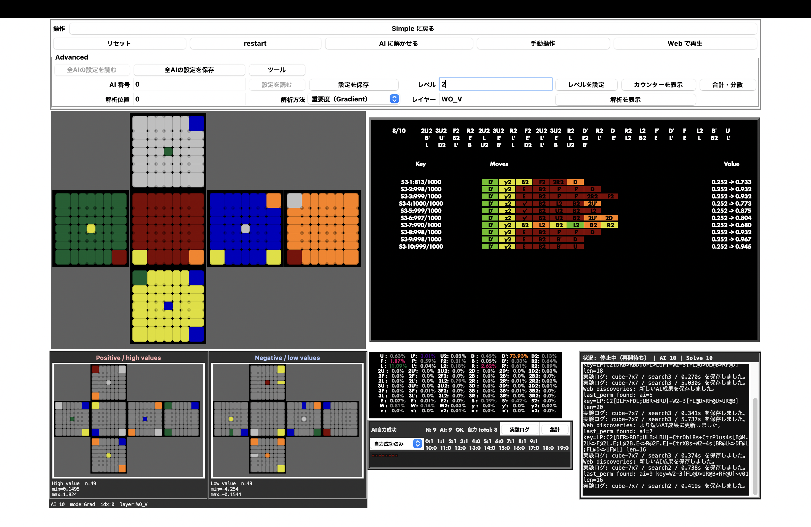
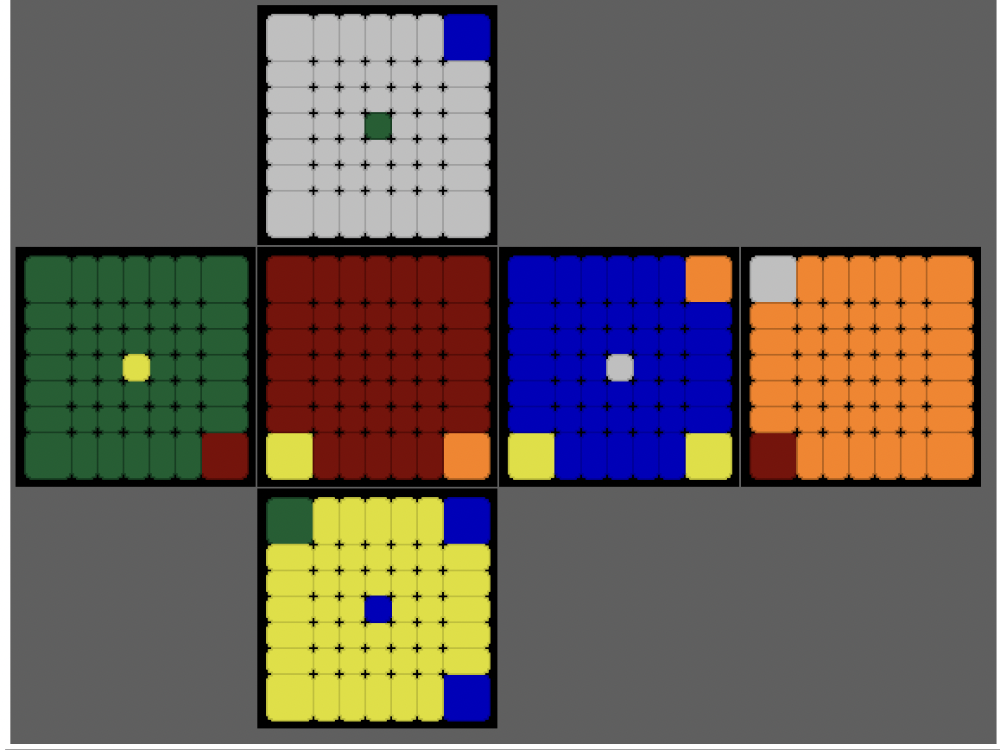
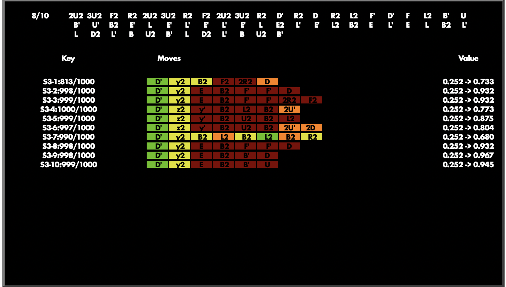
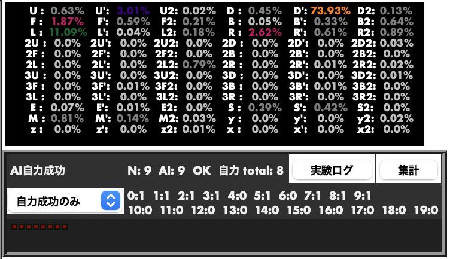
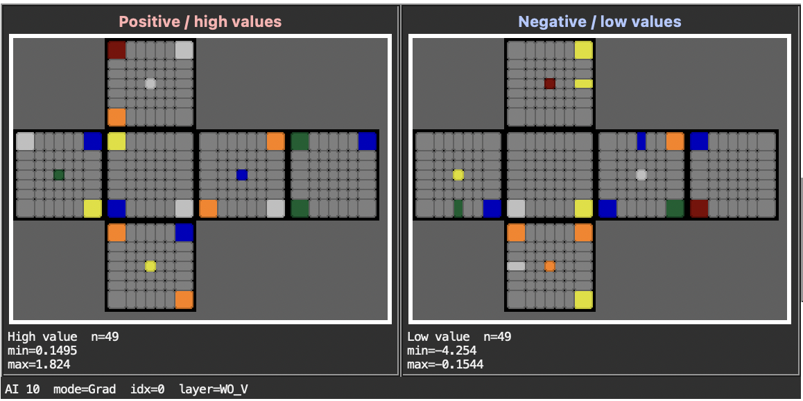
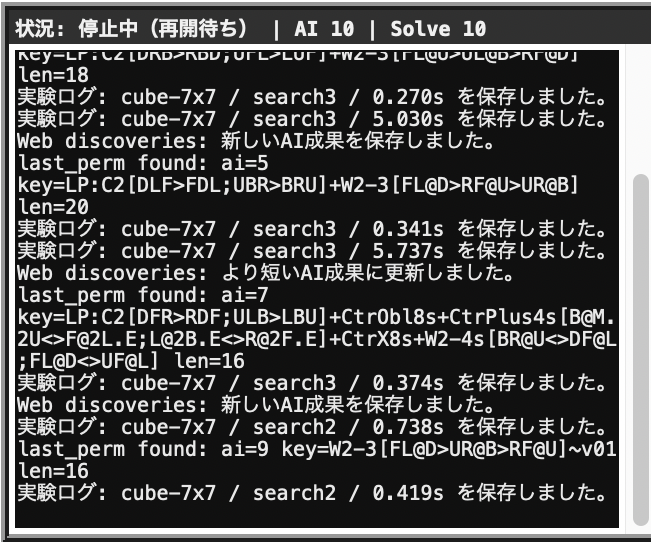

# Twisty Puzzle AI Lab

[](https://github.com/pcssuematsu-max/Rubiks_portfolio/actions/workflows/tests.yml)
[](LICENSE)

Twisty Puzzle AI Lab は、ツイストパズルを対象にした探索・学習実験用の Tkinter GUI アプリケーションです。
Rubik's Cube 系を中心に、複数パズルの状態表示、手動操作、自動ソルブ、学習データ収集、ニューラルネットワーク学習、解析ビューアをまとめて扱います。

## プロジェクト概要

- **目的:** ツイストパズルの状態表現、探索、学習、解析を一つのGUI上で比較・実験する
- **開発形態:** 個人開発（AI開発支援あり）
- **主な技術:** Python、Tkinter、NumPy、PyTorch（任意）
- **公開版:** 3×3 Rubik's Cube、Search2 1体、NumPyのみで起動できる軽量構成

## 開発時のチェック

開発用依存関係を入れると、未使用参照・未定義名・構文エラーをRuffで確認できます。

```bash
python3 -m pip install -r requirements-dev.txt
python3 -m ruff check .
```

同じチェックはGitHub Actionsでも実行されます。

## 同一局面の独立比較（実験用）

保存済みの実験用AIを、同じ固定局面から直接解かせる独立比較です。現在の `experiment` プロファイルは4×4キューブ・25体で、既定の局面群は `4x4-algorithms` です。通常の200試行、学習データ、GUIの成功カウンタには追加しません。Search2は複数回の探索を連結して完成まで判定し、Search3はプロファイルの探索条件（現在は固定10,000 playout）を使います。greedy fallbackが必要になった時点で直接失敗とします。

```bash
python3.14 tools/compare_ai_same_positions.py --list-fixtures
python3.14 tools/compare_ai_same_positions.py --fixture-set 4x4-algorithms --ai-indices 0,2,10,20,22
python3.14 tools/compare_ai_same_positions.py --fixture-set 4x4-myperm-composites --ai-indices 0,2,10,20,22
```

`4x4-algorithms` はWing、Corner、Centerの固定局面を、`4x4-myperm-composites` はmypermを組み合わせた別の固定局面を使います。`--ai-indices` を省略すると25体すべてを比較します。結果は通常の実験ログと別の `exports/ai-paired-benchmark.jsonl` に追記され、各AI・各局面の直接成功、探索量、深さ、保存済みパラメータの識別子を残します。比較前にGUIのパラメータを保存してください。これらは再現可能な固定サンプルであり、通常の200試行の出題分布そのものを代表するものではありません。

3×3用の `generated`、`perms`、`palms`、`all` は、実験プロファイルを3×3に切り替えた場合に使えます。現在の4×4設定のまま指定するとエラーになります。

4×4の通常ソルブログは、Effect数の計算時に得られる `setupEffect.effectClass` も短い文字列として保存します。手順そのものは引き続き保存しません。次のコマンドでEffect Type・設定手数帯・AI種別ごとの直接成功率を後から集計できます。旧ログには手順とEffect Typeが残っていないため、旧試行は分類不能として件数を表示します。固定比較ログには手順があるので、旧形式でもオフラインで分類できます。

```bash
python3.14 tools/analyze_effect_type_success.py exports/ai-experiments-cube-4x4.jsonl
python3.14 tools/analyze_effect_type_success.py AI_logs_storage/Rubiks_4x4/benchmarks/ai-paired-4x4-20261025-latest.jsonl
```

`--neighbor-probe` を付けると、同一初期局面でのPolicy上位手・Value上位手、各候補手の両順位、Valueが現在より高い後続局面数を各AIについて記録します。失敗した場合は探索終了時の局面も同じ方法で調べます。集計には、実際に成功したLinear AIの初手を他AIが何位に置いたかも残します。逆手順初手も比較用に記録しますが、唯一の正解手とは限りません。診断は固定比較の結果ファイルだけに保存され、学習データ・パラメータを変更しません。

4×4のmypermsから作った別のWing＋Corner連結3例と高Effect短手順2例は、`--fixture-set 4x4-myperm-composites` で検証できます。元のEffect 4・37手は引き続き検証専用です。学習側には異なるmypermの組み合わせとその対称変換から、同じ開始局面を重複排除した少量の補助手順を起動時に追加します。これは200試行の出題回数には含まれず、Search3では低い重みで使います。steps_to_goalの絶対Valueには、逆手順が最短とは限らないこの補助データを使いません。

同じ保存済みSearch3重みでFixedとProgressiveの完全な直接ソルブを比較するには `python3.14 tools/compare_search3_budgets.py --ai-indices 2,10 --fixture-ids wing-2-plus-corner-2-swap,myperm-wing-corner-a` を使います。これは現在の固定予算設定から探索方式だけを変える比較で、直接成功率、総playout数、探索回数を記録します。Original Search2が解いた経路の最初の数手についてPolicy/Value順位とSearch3のPUCT訪問比を調べるには `python3.14 tools/probe_success_routes.py --reference-ai-indices 0,9 --target-ai-indices 2,10 --max-probe-steps 5 --trace-search3-root` を使います。どちらも学習や保存済みパラメータには触れません。

複数回の固定比較結果から、同じfixture setだけで難しい手順の成功を優先してcheckpointを並べるには `python3.14 tools/rank_fixed_checkpoints.py 比較結果1.jsonl 比較結果2.jsonl` を使います。異なる固定局面群やパズル設定の結果は同列に比較しません。選択結果は一覧のみで、パラメータの自動置換は行いません。

steps_to_goalの学習MAE、固定手数帯別MAE、gradient、同一局面の目標衝突率は `python3.14 tools/analyze_steps_to_goal_drift.py` で直近20回とその前20回を比較できます。4×4実験ではAI20を従来どおり最短観測ラベル採用の対照群とし、AI22だけ衝突した局面を絶対Value学習から除きます。Policyの学習例は維持し、除いた件数を学習履歴の `stepsToGoalRegression.valueSelection.excludedAmbiguousValueStateCount` に残します。

3×3プロファイルへ切り替えた場合は、`tools/sweep_search3_inference.py` でCと枝幅、`tools/sweep_search3_policy_temperature.py` でPolicy温度、`tools/compare_linear_transformer_routes.py` でLinearの成功経路に対するTransformerのPolicy/Valueを比較できます。これらは3×3固定局面用で、現在の4×4プロファイルのままでは実行できません。各結果は独立したファイルへ書き込み、学習率や保存済み重みは変更しません。実行前にGUI側でパラメータを保存してください。

AI22 の steps_to_goal には、直接探索が止まった後に成功したfallback経路のreplay採用比5%以上を目標にし（1経路の再採用は最大2回）、開始から3手の相対Value順位を補助学習します。候補不足なら無理に比率を満たさず、絶対手数のHuber目標も維持します。学習履歴には採用件数と追加損失を残し、既存の保存データには新しい停止印がないため、新たな成功fallbackから徐々に効き始めます。

学習履歴の先頭は Effect帯別の直接成功率を優先表示し、3×3の直接探索失敗時に限って停止局面のValue上昇候補数を小さな集計値として記録します。「失敗地点の上り道」は計測できた失敗だけを分母にするため、旧ログや他サイズの未計測分を0件として混ぜません。

実験プロファイルのAI22は、従来の `steps_to_goal` の絶対手数目標を維持したまま、選別済み成功経路の後続局面を高く評価する相対順位損失を追加します（margin 1.0、経路ごとに平均、係数1.0）。AI20およびpairwise群の設定・データ件数は変更せず、学習履歴には絶対損失と相対損失の内訳を別々に残します。

Transformer Search3 の replay 比較では、AI10/11/18/19 の探索条件（C=0.5、固定10,000 playout、枝幅）を揃えています。AI10/11 は rank loss 0.1 と recent 比率0.5のまま、recentと旧データを別バッチにする方式と混合する方式を比較します。AI18/19 は rank loss なしで、recent 比率0.5対0.25を比較します。短・中・長手数のreplay枠や実際の採用件数は学習履歴の `trainingSample` に記録します。

```bash
python3.14 tools/compare_ai_same_positions.py --fixture-set 4x4-algorithms --ai-indices 10,11,18,19
```

既存のパラメータは自動初期化しません。4体の過去の重み・学習履歴は異なるため、現在の成功率の絶対値だけでサンプラーの因果効果を判断せず、設定変更前後の同一AIの推移も確認してください。厳密な同一初期値実験には、別途チェックポイントを複製して学習を開始する必要があります。

## AI discoveries のデータ形式

AIが見つけた解法は `exports/ai-discoveries.json` に保存します。rootの `schemaVersion` は現在 `1` で、各成果について `puzzle`、`setup`、`moves`、`moveCount`、`foundAt`、`updatedAt` を検証します。効果解析できる成果には `effectName`、`effectClass`、`effectLabel`、`effectCount`、`orientationCount` も保存します。保存時には `myperms_point` が最大になる対称変換を選び、setupとmovesの両方を同じ向きへ正規化します。

`Points.txt` を変更した後、保存済みの成果にも新しい代表形を反映するには、まず移行件数を確認し、次に書き込みます。同じ開始手順へ合流した成果は短い解法を残し、同じ解法へ合流した成果は短いsetupを残します。書き込み時には元ファイルの圧縮バックアップを `exports/` に作成します。

```bash
python3 tools/migrate_ai_discoveries_points.py
python3 tools/migrate_ai_discoveries_points.py --write
```

Web公開時は、検証済みのJSONだけを次のコマンドでWebプロジェクトへ同期します。

```bash
python3 tools/publish_ai_discoveries.py
```

Webでは効果タイプとEffectNameを選び、同じ型の中で `effectCount² × moveCount` が小さい手順を比較できます。正式なJSON Schemaは [`schemas/ai-discoveries.schema.json`](schemas/ai-discoveries.schema.json) にあります。

## 制作背景

作者はスピードキューブを趣味とし、さまざまな解法や手順を覚えてきました。一方、大学院では代数学を研究し、群論を中心とする代数的な考え方を学びました。大学院在学中には、ニューラルネットワークを利用したパズルやテーブルゲームのAI解析を独学で実験していました。

その過程で、「ルービックキューブをニューラルネットワークで解析すると、人が使う既知手順とは異なるどのような手順を発見できるのか」という疑問を持ったことが、このプロジェクトの出発点です。

当初は独学で得た知識をもとに、Policy / Value による評価を使う独自の探索方式 Search2 を設計しました。その後、PUCT や Transformer を知り、Search3 や Attention モデルを追加しました。異なる特徴を持つ複数のAIを同時に学習させ、興味深い解法手順を発見することを目指しています。



*7×7 Rubik's Cube を使ったGUIの表示例。現在の `experiment` プロファイルの既定値は4×4です。*

## GUI画面の見方

メイン画面では、現在のパズル状態、探索で選ばれた手順、AIの出力、解析結果、実行ログを同時に追跡できます。公開用の `public` プロファイルは初期状態で **Simple** 表示になり、リセット・AIによるsolve・停止・手動操作を表示します。`Advanced を表示` を選ぶと、AI設定、解析方法、対象layer、ツールを開けます。以下の画像は7×7 Rubik's Cubeと複数AIを使った表示例です。既定の `public` は3×3・Search2 1体、現在の `experiment` は4×4・25体です。

Success Viewerは、既定で **自力成功のみ** を表示します。ここで数えるのはSearch2 / Search3が探索そのもので完成へ到達した結果だけで、既知手順を使うfallbackによる完了は混ぜません。AIごとの `成功数/Lv` も表示します。プルダウンで `すべて`、`Fallbackのみ`、`失敗のみ` に切り替えられ、`履歴` から直近10件の結果区分・setup・movesを確認できます。対応するパズルでは、選んだ記録を `Webで再生` して開始局面と手順をブラウザ上で追えます。

200試行の区切りでは、各AIがその区間で担当したplayを**すべて直接探索で成功**させた場合だけ、そのAIの該当stageのレベルが1上がります。fallback完了はレベル判定の直接成功には含めません。

### State Viewer



現在のパズル状態を展開図で表示します。solveの進行に合わせて更新され、スクランブルから完成状態へ変化する過程を目で追えます。Rubik's Cube以外の対応パズルでは、それぞれの形状に合わせた専用State Viewerへ切り替わります。灰色は、部分問題の実験などで評価対象から除外したステッカーを表します。

### Move Viewer



探索が採用した手順を時系列で表示します。上段はスクランブル手順、左上は成功数と試行番号です。各行の `Key` は探索結果の統計やmyperms名、`Moves` はその段階で適用した手順、`Value` は手順適用前後の評価値を表します。手順セルの色は、探索方式に応じた各move後の評価変化を示します。

### Policy Probability / Success Viewer / Log Viewer



左側は現在状態に対するPolicy出力で、各moveの選択確率をパーセント表示します。色によって確率の大小を素早く比較できます。Policyの下のSuccess Viewerは、現在の試行番号・AIごとの自力成功数とレベル・累計を表示します。`履歴` では直近10件を、`集計` では探索成功・Fallback完了・失敗を別々に比較できます。右側は探索・学習のログです。

### Grad Viewer



選択したAIとlayerについて、入力のどの位置が評価へ強く影響したかをパズル上に重ねて表示します。左側が正方向または高い値、右側が負方向または低い値で、下部には抽出数と値域が表示されます。`Grad` のほか、Integrated Gradients、Occlusion、Attention、Embeddingなどへmodeを切り替え、異なる観点から判断根拠を比較できます。

### Log Viewer



探索結果、学習指標、パラメータ統計、データ件数、PyTorch利用状況、メモリ使用量などを時系列で表示します。上部の固定欄には `待機中`・`探索中`・`フォールバック中` など現在の処理段階を1行で表示します。長時間の実験でも最新行へ自動スクロールし、表示行数を制限してGUI側のログが増え続けないようにしています。

## 設計と実装の見どころ

- **複数パズルへの対応:** Rubik's Cube 系、Megaminx、Pyraminx、Skewb、Square-1、FTO、CTOを `PuzzleAdapter` の登録情報から生成し、有限群パズルも共通GUIに接続
- **探索方式の比較:** Policy / Value を使う優先度探索の Search2 と、PUCT 型探索木を使う Search3 を実装
- **学習過程の可視化:** Grad、Integrated Gradients、Occlusion、Attention、Embedding などをGUIから解析
- **実験条件の分離:** 閲覧者向けの `public` と、探索・学習用の `experiment` を同じ起動入口から切り替え可能
- **検証可能性:** パズル状態、手順命名、有限群、起動プロファイルを自動テストし、GitHub Actionsでも継続的に確認

## 技術的に難しかった点

特に難しかったのは、探索状況に応じて複数のアルゴリズムを切り替える条件分岐です。例えば、通常の探索で解けなかった場合には、登録済み手順や評価値を使って別の方法で解を探す `myval greedy` をフォールバックとして実行します。fallbackで完了した結果は有用な比較データとして実験ログへ残しますが、AIが自力で見つけた探索成功とは別の結果区分として扱います。

探索の成功・失敗とフォールバック処理を組み合わせるにつれて制御が複雑になったため、現在はsolve、learn、parameter、datasetなどの責務をmanager単位に分け、起動条件も `FrameConfig` とプロファイルへ分離しています。

## 公開版について

`python3 main.py` は、ポートフォリオ閲覧者向けの軽量な `public` プロファイルを既定で起動します。現在の `experiment` プロファイルは `cube_size = 4`, `puzzle_type = 'cube'`, AI 25体です。設定は [`configs/profiles.py`](configs/profiles.py) で変更できます。

公開版では、3×3キューブをSearch2がどのように学習し、解けるようになっていくかを確認できます。このリポジトリには学習済みパラメータを含めていないため、起動直後のAIはランダムなパラメータから始まり、はじめは見当違いな動きをします。学習が進むにつれて、どのような手順を良いものとして評価するかを自動的に獲得していきます。

多分割キューブやMegaminxなどは状態空間が大きく、一般的な解法を一から獲得することは非常に困難です。一方で、対象を特定のパターンに限定した実験では、実用的な時間内に解法を発見できる場合があります。

## 開発体制とAI支援について

プロジェクトの着想と初期設計、Rubik's CubeおよびMegaminxのGUI、内部処理の大部分は、Codex登場以前に作者が実装しました。独自探索方式Search2の設計と、初期のAI実験も作者が行っています。

Codexを利用するようになってからは、既存のRubik's Cube・Megaminx実装を土台として、Pyraminx、SkewbなどのパズルのGUIと内部データの実装を支援してもらいました。また、責務ごとのファイル分割を含むリファクタリング、公開用リポジトリの整理、READMEの改善、自動テストの追加にもCodexを使用しています。

Codexによる提案・実装内容は作者が確認し、既存設計との整合性や動作をテストした上で採用しています。

## 主な機能

- 手動操作と自動ソルブを同じ GUI で実行
- Search2: Policy / Value を使う priority 型探索
- Search3: PUCT ベースの探索木探索
- myperms: 既知手順・発見手順を使う Greedy fallback
- Search2 / Search3 学習データの登録、簡約、保存、再利用
- Original MLP / Residual / Attention 付き Original Transformer 風モデルの実験
- NumPy 実装と PyTorch 推論・学習の切り替え
- Grad / Integrated Gradients / Occlusion / Attention / Embedding 解析
- Dataset Inspector と sample replay
- 学習ログ、探索ログ、last_perms、lp_show、パラメータ編集 GUI

## 対応パズル

`FrameConfig.puzzle_type` で切り替えます。

- `cube` / `rubiks`: 2x2 から多分割 Rubik's Cube 系
- `megaminx`: Megaminx
- `pyraminx`: Pyraminx
- `master_pyraminx`: Master Pyraminx
- `skewb`: Skewb
- `square1`: Square-1
- `fto`: Face-Turning Octahedron
- `cto`: Corner-Turning Octahedron
- `group`: 対称群または素体上の有限線型群（`group_main.py` から起動）

各パズルの状態遷移は `cube/`, `megaminx/`, `pyraminx/`, `skewb/`, `square1/`, `fto/`, `cto/` に分かれています。
パズル固有の StateViewer は `ui/<puzzle>/state_viewer.py` にあります。
`core/puzzle_registry.py` の `PuzzleAdapter` が状態モデル生成、Viewer生成、手順表示、Effect解析の入口をまとめています。有限群パズルは `group_main.py` の設定から生成します。

## 実行方法

```bash
python3 -m venv .venv
source .venv/bin/activate
python3 -m pip install -r requirements.txt
python3 main.py
```

引数なしでは、3×3 Rubik's Cube、Search2 1体、PyTorch不使用の公開用構成で起動します。

従来の探索・学習実験用構成は、次のように明示して起動します。

```bash
python3 main.py --profile experiment
```

`--profile test` も `experiment` の別名として利用できます。自動テストを置く `tests/` と区別しやすいため、READMEでは `experiment` を推奨表記にしています。

Python 3.10 以降に対応し、Python 3.14 で動作確認しています。Tkinter の GUI が起動します。macOS などで Tkinter が入っていない Python を使っている場合は、Tk 対応の Python を使ってください。

### 有限群パズル

既定の対称群パズル（`S_3`）は次で起動できます。

```bash
python3 group_main.py --kind symmetric --degree 3
```

線型群の既定例（`GL(2, F_2)`）は次です。

```bash
python3 group_main.py --kind linear --dimension 2 --modulus 2
```

対称群の状態は 1-based one-line 表記、線型群の状態は行列の row-major flatten です。生成元は常に左から作用します。AI 入力は、対称群では各位置ごとの `n` 次元 one-hot、線型群では各行列成分ごとの `p` 次元 one-hot を連結したものです。

独自の生成元は `build_group_frame_config(..., generators=...)` へ辞書で渡します。対称群では `1..n` の置換、線型群では `F_p` 上の正則行列を指定してください。生成元集合に各逆元が含まれない場合は起動時にエラーになります。

```python
from group_main import build_group_frame_config

config = build_group_frame_config(
    kind="symmetric",
    degree=3,
    generators={
        "s": [2, 1, 3],
        "r": [2, 3, 1],
        "r^-1": [3, 1, 2],
    },
)
```

`group` mode は myperms を登録・利用せず、level `L` のスクランブルを生成元集合 `X` の長さ `L` のランダム word で作ります。探索器へ渡るのは結果の群要素の状態表現です。
学習パラメータは生成元設定ごとにローカルの `GroupAIdatas/` 以下へ保存され、cube 用の `AIdatas*` とは分離されます。これらの生成データはリポジトリには含めません。

`SL_2(F_43)` の編集可能な実験例は `group_experiment.py` にあります。

```bash
python3 group_experiment.py
```

このファイルの `DIMENSION`, `MODULUS`, `GENERATORS`, AI数、`AI_SEARCH_MODES`, `FRAME_OPTIONS` を変更すれば、実験条件を一か所で差し替えられます。`AUTO_ADD_INVERSES = True` の場合、不足する逆元を自動追加します。既定例の入力 `A, B` は内部で `X = {A, A^-1, B, B^-1}` になります。AI構成は cube 実験と同じく、Search2の通常Linearモデル10体とpiece-token Transformerモデル10体です。

Tools の `embedding map` と `embedding analysis` は群入力にも対応します。線型群では各点を `a00 / value=5` のように表示し、対角・非対角成分または行で色分けできます。通常Linear AIでは `W1`、Transformer AIでは `W1` に加えて `WQ1 @ W1`, `WK1 @ W1`, `WV1 @ W1` を解析できます。

## 依存関係

必須（`requirements.txt`）:

- Python 3.10 以降
- NumPy 1.23 以降、3.0 未満
- heapdict 1.x
- Tkinter

任意:

- PyTorch 2.1 以降: Transformer / Torch 推論・学習を使う場合

例:

```bash
python3 -m pip install -r requirements-torch.txt
```

`torch` は環境依存が大きいので、不要なら入れなくても NumPy 側の処理は動きます。

## テスト

```bash
PYTHONDONTWRITEBYTECODE=1 python3 -m unittest discover -s tests -v
```

GitHub Actions では Python 3.10 と3.14の両方で同じテストを実行します。

## 設定の変更

起動入口と設定本体を分離しています。

- `main.py`: コマンドライン引数の受付とGUI起動
- `configs/profiles.py`: `public` / `experiment` の具体的な設定
- `configs/__init__.py`: プロファイル名から設定を選ぶ窓口

ポートフォリオの初回体験を変える場合は `build_public_frame_config()`、ローカルの探索・学習条件を変える場合は `build_experiment_frame_config()` を編集します。

よく変更する項目:

- `cube_size`: Rubik's Cube 系のサイズ
- `puzzle_type`: 起動するパズル種別
- `ai_search_modes`: 各 AI の探索方式 (`search2`, `search3`。Transformerは別の設定で有効化)
- `search3_progress`: Search3 budget 時に fallback prefix へ進めるか
- `search3_cs`, `search3_budget_modes`, `search3_budget_stage_playouts`: Search3 の C・予算方式・段階別playout数（現在の実験版は固定10,000 playout）
- `lrs`, `wdlrs`, `adam`, `weight_decay`: optimizer 設定
- `activations`, `silu_beta_initials`: 活性化関数とAIごとのSiLU Beta初期値（現在の実験版は0.2）
- `update_scales`: shared / policy / value head の更新スケール
- `residuals`: Original AI の residual block 有効化
- `original_transformer_attention`, `original_transformer_linear_skips`: attention blockと直接線形branchを使うか
- `transform_idx`, `flip_inside_idx`: 変換・鏡映を固定するか
- `priority_list`: Greedy fallback で注目する group の順序
- `bootstrap_datas`, `bootstrap_search3_datas`: 起動時に追加する初期データ

GUI 起動後は Tools から parameter editor / dataset inspector / attention analysis などを開けます。`Frame.initialize(N)` は対象AIのSiLU Betaを設定値へ戻し、`Frame.initialize(N, beta=1.0)` のように明示値も渡せます。GUIの `選択AIを正規化…` はパラメータとoptimizer状態を変更するため、先に `設定を保存` で復元点を作ってください。

## 探索と学習データ

### Search2

Search2 は、Policy 出力で候補手を広げ、Value が高い状態を優先する探索です。
探索結果の move sequence は簡約して Search2 データへ登録します。

### Search3

Search3 は PUCT 型探索です。
各ノードは Policy prior と Value backup を使って選択されます。
Search3 の学習データは solve 履歴から作られ、move sequence は簡約後に登録されます。
Value target は残り手数と `value_target_gamma` を使って再計算されます。
現在の実験プロファイルはSearch3を固定10,000 playoutで動かし、浅い枝幅から訪問数に応じて候補手を増やします。段階的な予算配分と早期停止の設定は比較実験用に残しています。

Search3 データには以下の区別があります。

- `search_mode`: データ片を生成した探索方式
- `end_reason`: `solved`, `budget`, `budget-greedy`, `bootstrap` など
- `source_succeeded`: その探索結果自体が成功したか
- `solve_succeeded`: その solve 全体が成功したか

### myperms / Greedy fallback

`cube.rubiks_cube.Rubiks_3.myperms` には、交換・回転・flip・parity 補正などの手順が登録されています。
Search が解を見つけない場合でも、myperms を評価して Greedy に進めることがあります。
発見した短い手順は `last_perms` としてログ・表示されます。

全パズルの `myperms` key は `MypermKey(name, transform_index)` で統一されています。
登録手順の `name` は代表変換の効果名を使い、画面・ログでは `name#NN` と表示します。`#00` は `myperms_point` が最大の対称変換で、残りはその代表手順を基準に対称変換の番号順へ割り当てます（点数順ではありません）。
旧手順名はaliasとして解決できます。
単一 move は `SingleMove-<move>` という名前を使います。
効果ベースの命名規則と向きの表現は [`docs/myperm_naming.md`](docs/myperm_naming.md) にまとめています。

Greedy fallback では各AIのPolicyから手ごとの `-log(確率)` を求め、myperm内の合計が小さい候補から評価します。Transformerでも実際のPolicyを使います。`lp show` のkey選択は登録mypermを優先し、Effect数、発見済み最短手数の順に並べ、候補欄にも最短手数を表示します。

## 解析ツール

GUI の Tools から主に以下を使います。

- `edit params`: AI パラメータの確認・編集
- `dataset inspector`: Search2 / Search3 データセットの概要、代表 sample 表示、sample replay
- `attention analysis`: Attention の重要度・関係性の表示
- `embedding analysis`: piece embedding の norm / PCA / cosine 類似度表示
- `lp show`: last_perms の手順表示
- `make myperm`: 現在の手順から myperm 登録用 key を作る補助

GradViewer 系では以下の mode を切り替えられます。

- `Grad`
- `IG`
- `Occ`
- `PieceOcc`
- `PolicyOcc`
- `PiecePolicyOcc`
- `AttnIn`, `AttnOut`, `AttnCentral`
- `EmbNorm`, `EmbPC1`

## ディレクトリ構成

```text
main.py                  プロファイル選択とアプリ起動
configs/                 公開用・実験用の起動設定
group_main.py            有限群パズルの起動入口
group_experiment.py      有限群の編集可能な実験例
ai/                      Original AI、layer、loss
core/                    PuzzleAdapter registry、Effect解析、scramble selector
cube/                    Rubik's Cube 系、Search2/Search3 engine、myperm analyzer
megaminx/                Megaminx の状態・操作
pyraminx/                Pyraminx / Master Pyraminx
skewb/                   Skewb
square1/                 Square-1
fto/                     FTO
cto/                     CTO
group_puzzle/            対称群・有限線型群パズル
managers/                solve / learn / params / debug / dataset 管理
model/                   SearchResult と学習データ構造
ui/                      Tkinter UI、viewer、dialog
tools/                   独立実行用の補助ツール
tests/                   自動テスト
docs/                    設計・命名規則の詳細
reports/                 ツールが生成する解析レポートの説明
```

## データとモデル

学習済みパラメータ、optimizer state、収集した学習データ、生成レポートは実行時の成果物として扱い、Git では管理しません。

- `AIdatas*/`: 各 AI のパラメータ
- `GroupAIdatas/`: 有限群実験のパラメータ
- `Datas/`, `Datas.binaryfile`: 収集した学習データ
- `reports/*.csv`: 補助ツールが生成する解析レポート

パラメータファイルが存在しない場合、モデルは初期値から起動します。公開用の学習済みモデルを配布する場合は、GitHub Releases などから個別にダウンロードする形を想定しています。

## Git 管理上の注意

仮想環境、キャッシュ、OS・エディタ生成ファイル、学習データ、モデルパラメータ、生成レポートは Git 管理しません。特に `.npy` を大量に含む `AIdatas*/` などは、リポジトリサイズを急増させるためコミットしないでください。

## ライセンス

このプロジェクトは [MIT License](LICENSE) のもとで公開しています。

## 開発メモ

このリポジトリは研究・実験用のコードです。
公開確認では既定の `public`、探索・学習作業では `--profile experiment` を指定し、用途を混同しないようにしてください。
